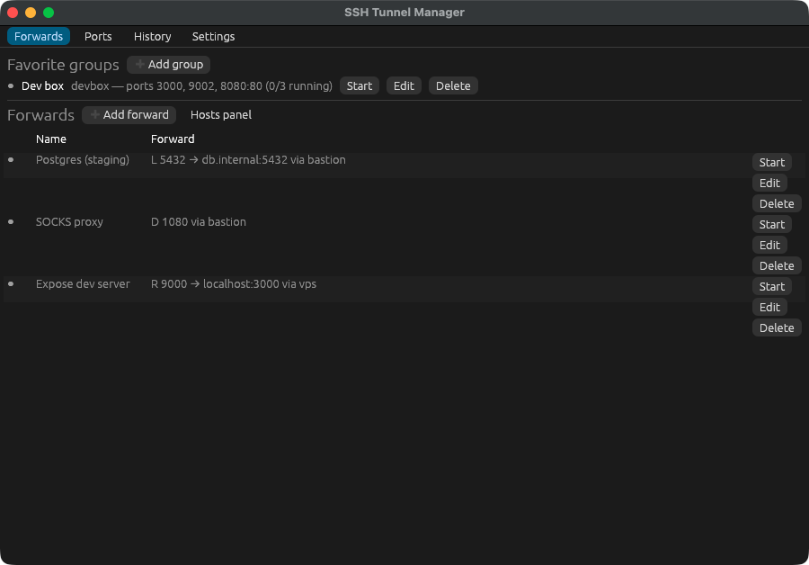

# SSH Tunnel Manager

A small cross-platform desktop app (Rust, egui) for managing SSH port forwards without touching `~/.ssh/config`. It lives in the system tray, keeps a history of sessions, shows which local ports are in use, and offers the hosts it finds in your SSH config.



## Features

- **Forwards:** local (`-L`), remote (`-R`) and dynamic (`-D`), with a live preview of the exact `ssh` command.
- **Favorite groups:** one server plus several ports (`3000 9002 80`, or `8080:80` for local:remote), started and stopped with one click. Each port is its own `ssh` process with its own status.
- **Tray:** closing the window hides it; the tray menu starts/stops forwards and groups. Optional start-minimized and launch-at-login.
- **Auto-reconnect:** exponential backoff from 1s to 60s, per forward or group.
- **Ports tab:** TCP listeners on this machine, which ones belong to your tunnels, and conflict warnings when you pick a port.
- **History:** every session, with Re-run.
- **Hosts:** aliases from `~/.ssh/config` (including `Include`s) resolved with `ssh -G`, hostnames from `known_hosts`, and hosts you used before.
- Desktop notification when a tunnel fails; single-instance (a second launch shows the first window).

## Requirements

- An OpenSSH client (`ssh`) on `PATH` (Windows 10+ ships one). Override the path in Settings.
- **Key or agent authentication only.** Tunnels run with `BatchMode=yes`, so there are no password prompts. Passphrase-protected keys must be loaded in an agent. On macOS apps launched from Finder have no `SSH_AUTH_SOCK`; the app asks `launchd` for it, or set it in Settings.
- Windows 10+, macOS 12+, or Linux with a system tray (GNOME needs the AppIndicator extension).
- Building on Linux: `libgtk-3-dev libayatana-appindicator3-dev libxdo-dev`.

## Build and run

```
cargo run
cargo test
cargo clippy --all-targets -- -D warnings
```

Installers (`.msi`, `.dmg`/`.app`, `.deb`, AppImage) via [cargo-packager](https://github.com/crabnebula-dev/cargo-packager): `cargo install cargo-packager --locked && cargo packager --release`.

## Where things are stored

| File | Location |
|---|---|
| `forwards.json`, `groups.json`, `settings.json` | config dir |
| `history.jsonl`, `app.log` | data dir |

Both are under the OS-standard app directories for `dev.kratos.ssh-tunnel-manager`; Settings has buttons to open them.

## Known limits

- Password / keyboard-interactive auth is not supported.
- A hard kill (`kill -9`) of the app orphans its `ssh` children on macOS; Windows (job object) and Linux (parent-death signal) clean up.
- Extra options are split on whitespace, with no shell quoting.
